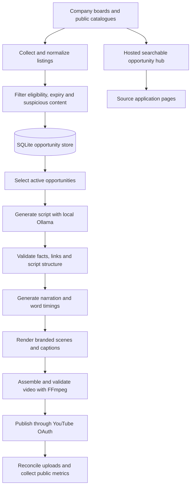

<div align="center">

# Unemployer

**From verified career listings to captioned YouTube Shorts.**

An automated pipeline for discovering Indian-eligible internships and fresher jobs, generating original narration with local Ollama, and publishing branded vertical videos.

[](https://www.python.org/)
[](https://ollama.com/)
[](https://www.youtube.com/@unemployerr)

[Live opportunity hub](https://unemployer.syrupytide17.chatgpt.site) · [YouTube channel](https://www.youtube.com/@unemployerr) · [Watch an example Short](https://www.youtube.com/shorts/PMGllSvFWdc)

</div>

---

## Overview

Unemployer connects opportunity discovery, content generation, video production, and YouTube publishing in one workflow. It prioritizes early-career openings that Indian applicants can apply to, including eligible international and remote roles.

The local worker handles collection and video publishing. A separate hosted website lets viewers search openings and reach their source application pages, even when the video-generation laptop is offline.

## Features

- **Opportunity discovery:** 23 configured targets across company career boards, public catalogues, and selected employer pages.
- **Eligibility filtering:** India locations and explicitly eligible international or remote roles, with senior-role, expiry, and suspicious-listing filters.
- **Local script generation:** Ollama narration with factual employer/role hooks, application guidance, relevant hashtags, and a light Hinglish preference with English permitted.
- **Branded video production:** four HTML scenes, Indian-English narration, highlighted captions, subtle motion, normalized audio, and vertical H.264/AAC output.
- **Automatic publishing:** active queued videos publish as soon as processing allows, with no per-video approval in automatic mode.
- **Operational safeguards:** duplicate prevention, source freshness checks, upload reconciliation, retry cooldowns, rotating logs, health reports, and database backups.
- **Public opportunity hub:** searchable listings, application redirects, a free checklist, and sponsorship contact.
- **Performance snapshots:** public YouTube views, likes, comments, visibility, and processing status.

## How it works



**Scheduling:** the Windows task starts a persistent Python worker at user login. The worker refreshes sources 15 minutes after the previous collection finishes, processes a bounded queue, and waits approximately one minute between cycles. Python does not need to be relaunched every 15 minutes. Collection, generation time, connectivity, and API limits can delay publication.

## Technology

| Component | Implementation |
| --- | --- |
| Collection | Python, Requests, Beautiful Soup, public ATS APIs |
| Configuration | YAML and environment overrides |
| Storage | SQLite with WAL and consistent online backups |
| Script generation | Local Ollama; configured model: `qwen3:8b` |
| Narration | Edge TTS with Indian-English voices |
| Scene rendering | Jinja2, HTML/CSS, Playwright Chromium |
| Video and captions | FFmpeg, FFprobe, ASS captions |
| Dashboard | Streamlit |
| Publishing | YouTube Data API v3 and Google OAuth |
| Public hub | Hosted Worker with live feeds and public-only fallback data |
| Verification | Pytest and hub route/safety checks |

## Quick start

### 1. Prepare the environment

Install Python 3.11 or newer, [Ollama](https://ollama.com/), and FFmpeg with FFprobe available on `PATH`. Allow sufficient free memory for your chosen model. Internet access is required for collection, Edge TTS, and YouTube uploads.

From the repository root, enter the application directory:

```powershell
cd opportunity-shorts
python -m venv .venv
.\.venv\Scripts\Activate.ps1
python -m pip install -r requirements.lock.txt
python -m playwright install chromium
Copy-Item .env.example .env
```

If you already opened the application directory, skip the `cd` command. `requirements.lock.txt` records tested direct dependency versions; it does not fully pin transitive dependencies. `requirements.txt` contains the broader dependency requirements.

### 2. Start Ollama

```powershell
ollama pull qwen3:8b
ollama serve
```

If Ollama is already running through its desktop application, a second server is unnecessary. The shipped configuration uses CPU inference (`num_gpu: 0`). Adjust the model and inference settings for your hardware in [config/shorts.yaml](opportunity-shorts/config/shorts.yaml).

**No Anthropic or other paid LLM API key is used.** Ollama runs locally. Edge TTS also requires no user-supplied API key, but it is an online service.

### 3. Configure the project

| File | Purpose |
| --- | --- |
| [.env.example](opportunity-shorts/.env.example) | Local environment-variable template |
| [config/settings.yaml](opportunity-shorts/config/settings.yaml) | Collector behavior and eligibility filters |
| [config/boards.yaml](opportunity-shorts/config/boards.yaml) | Configured company career boards |
| [config/sources.yaml](opportunity-shorts/config/sources.yaml) | Public catalogues and employer pages |
| [config/shorts.yaml](opportunity-shorts/config/shorts.yaml) | Ollama, narration, visuals, automation, uploads, and business links |

For another channel, update `upload.expected_channel_handle`, `upload.expected_channel_id`, and the business contact/hub settings before connecting YouTube. The shipped configuration targets **@unemployerr** and requests **public uploads**. To prepare everything before enabling unattended operation, set `automation.enabled: false`; switch it to `true` when ready to publish automatically.

### 4. Connect YouTube

1. Create a Google Cloud project and enable **YouTube Data API v3**.
2. Configure the OAuth consent screen and create a **Desktop app** OAuth client.
3. Save the downloaded client JSON as `secrets/client_secret.json`.
4. If using another location, set `YOUTUBE_CLIENT_SECRETS_FILE` in `.env`.
5. Authorize the account that owns or manages the configured channel:

```powershell
python -m shorts auth
python -m shorts doctor
```

Authorization is a one-time account connection; revoked or expired consent may require reconnection. Upload and read-only YouTube permissions support publishing, channel verification, and uncertain-upload recovery. Keep both client credentials and `secrets/youtube_token.json` private.

### 5. Collect and inspect opportunities

```powershell
python -m collector run
python scripts/source_report.py
python -m shorts review
```

The Streamlit dashboard supports opportunity inspection, video previews, script editing, rejection, and exports. Manual approvals apply when automatic mode is disabled.

### 6. Enable the worker

With `automation.enabled: true`, install the current-user Windows task:

```powershell
.\scripts\install_worker.ps1
```

This installs and starts **UnemployerWorker**. Keep the computer awake, online, and logged in, with Ollama running. Logging out ends the interactive worker; logging in starts it again.

For a foreground alternative:

```powershell
python -m shorts daemon
```

Run only one publishing worker. Stop the scheduled task before running a foreground daemon or moving publishing to another laptop.

## Common commands

Run these from the application directory with its environment active.

| Command | Purpose |
| --- | --- |
| `python -m shorts doctor` | Check runtime dependencies and configuration |
| `python -m collector run` | Refresh configured opportunity sources |
| `python scripts/source_report.py` | Report source coverage and stored opportunities |
| `python -m shorts review` | Open the local dashboard |
| `python -m shorts generate <id> --save` | Generate and store a script |
| `python -m shorts build <id>` | Build a vertical video |
| `python -m shorts upload <id> --dry-run` | Prepare upload details without publication |
| `python -m shorts upload <id>` | Upload the selected video |
| `python -m shorts run-daily` | Run one cycle without publication |
| `python -m shorts run-daily --upload` | Run one cycle with publication |
| `python -m shorts health` | Read the latest worker health report |
| `python -m shorts metrics --refresh` | Refresh public YouTube performance snapshots |
| `python -m shorts backup` | Create today's consistent database backup |

Worker controls:

```powershell
Get-ScheduledTask -TaskName UnemployerWorker
Stop-ScheduledTask -TaskName UnemployerWorker
Start-ScheduledTask -TaskName UnemployerWorker
```

## Sources and coverage

The configured collector includes **15 employer boards, three public catalogues, and five selected employer pages**. Supported ATS integrations include Greenhouse, Lever, and Ashby; public catalogue integrations include Unstop, AICTE, and Himalayas.

Coverage is configuration-driven and bounded. It is not a universal directory of every company or internship. An enabled source may have no matching openings, and provider availability changes. Internshala is a reference channel/source investigated in the project; its listing collection is not presented as an active unrestricted integration. Remotive's adapter remains disabled pending redistribution permission.

Add a supported company board:

```powershell
python -m collector add-board https://jobs.lever.co/company-slug --company "Company name"
python -m collector run
```

A public board slug is an identifier, not an API secret. Remote work alone does not establish Indian eligibility. Candidates should check the original listing for residency, visa, academic, and timezone requirements.

See the [source inventory](opportunity-shorts/docs/SOURCES.md) for integrations, access details, and coverage limitations.

## Reliability and operations

| Safeguard | Behavior |
| --- | --- |
| Source freshness | Automatic uploads require a source check within the last 24 hours |
| Content validation | Checks script structure, known source facts, links, expiry, layout, and duration |
| Duplicate prevention | Tracks opportunity/post state and reconciles uncertain uploads |
| Retry handling | Failed builds and explicit upload rejections use cooldowns; uncertain uploads remain held for reconciliation |
| Upload limits | Configured daily caps remain subject to Google project and channel quotas |
| Database backups | One consistent daily backup; seven retained files |
| Worker logs | Rotating logs at `data/opportunities.worker.log` |
| Health reports | Cycle start/end status at `data/worker-health.json` |
| Metrics | Public YouTube counts refreshed every six hours |

Automatic validation cannot establish every prose claim. Health reports describe cycle progress rather than a continuous liveness guarantee. Public counts do not expose retention, swipe-away rate, CTR, or revenue.

For restoration, migration, and deployment procedures, use the [production runbook](opportunity-shorts/docs/PRODUCTION.md).

## Public hub and revenue

The [live hub](https://unemployer.syrupytide17.chatgpt.site) runs independently of the laptop. It fetches configured public feeds on demand, uses a best-effort 15-minute cache, and expires dated fallback listings after 24 hours. It does not run Ollama or generate/upload videos.

Add the hub URL to **YouTube Studio → Customization → Profile → Links**. This is a manual channel setup step; the project's upload OAuth integration cannot edit profile links.

Sponsorship enquiries: **[mananndudeja@gmail.com](mailto:mananndudeja@gmail.com)**.

The product provides a sponsorship contact and a free application checklist. Payment processing, paid products, sponsor acquisition, and YouTube monetization approval are not automatically activated. Growth strategies are experiments to measure; virality and earnings are not guaranteed.

## Project structure

```text
opportunity-shorts/
├── assets/                 # Branding, fonts, and media assets
├── collector/              # Source adapters, filters, scoring, and storage
├── config/                 # Collector and video-pipeline settings
├── docs/                   # Setup, source audits, and operational guides
├── scripts/                # Worker installation and maintenance utilities
├── shorts/                 # Scripts, TTS, rendering, publishing, and dashboard
├── sites/unemployer/       # Hosted opportunity hub source
├── tests/                  # Python regression tests
├── .env.example            # Environment template
├── requirements.txt        # Dependency requirements
└── requirements.lock.txt   # Tested direct dependency versions
```

Local runtime output lives in `data/`, `out/`, and `secrets/`. Do not publish credentials, OAuth tokens, databases, or private operational output.

## Verification

```powershell
python -m pytest -q --basetemp data/pytest-local
```

Last verified release: **107 passed, 6 historical placeholders skipped**. Hub route/safety checks and desktop/mobile browser checks also passed. A real production Short was verified public and processed at **1080 × 1920**, H.264/AAC, with a duration of approximately **33 seconds**. These are release verification results, not live CI status or coverage guarantees.

## Documentation

- [Automatic publishing and OAuth setup](opportunity-shorts/docs/AUTOMATION.md)
- [Production operations and revenue setup](opportunity-shorts/docs/PRODUCTION.md)
- [Source inventory](opportunity-shorts/docs/SOURCES.md)
- [Growth audit and editorial guidance](opportunity-shorts/docs/GROWTH.md)
- [End-to-end operating notes](opportunity-shorts/docs/END_TO_END.md)
- [Opportunity data contract](opportunity-shorts/docs/DATA_CONTRACT.md)
- [Reference-channel source audit](opportunity-shorts/docs/CHANNEL_SOURCES.md)
- [Brand assets](opportunity-shorts/assets/branding/README.md)

## Contributing

Keep source adapters isolated, preserve original application URLs, and add meaningful regression tests for changes to eligibility, validation, or publishing behavior. Describe the source access requirements and run relevant checks before submitting a change. Never include local secrets or user data in a contribution.

## License

No project license is currently included. Add a license before distributing this repository under explicit open-source terms.
